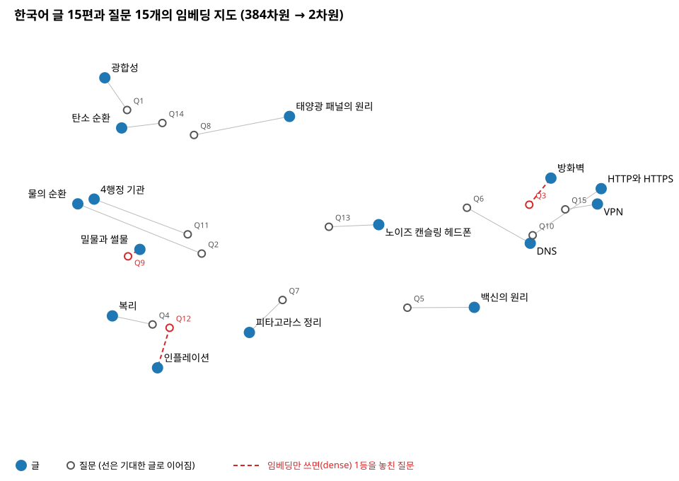
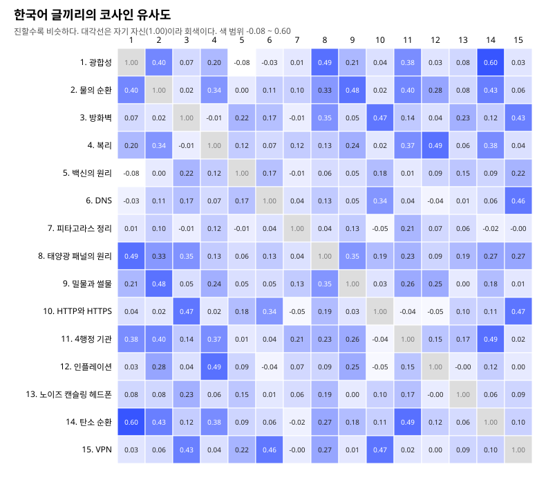

# 2. 임베딩: 문장을 숫자로

> 임베딩 모델은 문장을 숫자 384개로 바꾼다. 뜻이 비슷한 문장은 숫자들의 「방향」이 비슷해지도록 미리 학습되어 있다.

> 이 장은 15편으로 잰 실측 장이다. 벡터, 내적, 코사인, 다섯 단계를 손 계산과 실습으로 세우는 기초는 [C. 임베딩의 기초](C-vectors.md)에 있다.

## 이 장에서 알게 되는 것

- 문장 하나가 숫자 384개가 되기까지의 다섯 단계
- 코사인 유사도가 무엇이고 왜 쓰는지
- 15편이 숫자 공간에서 실제로 어떻게 모여 있는지 (그림)
- 임베딩 모델이 한 번에 읽을 수 있는 길이의 한도

## 왜 필요한가

「식물은 햇빛을 어떻게 에너지로 바꾸나?」라는 질문에는 「광합성」이라는 낱말이 없다. 낱말이 겹치는지만 세면 광합성 글을 못 찾는다. 사람은 둘이 같은 이야기라는 걸 안다. 컴퓨터가 이걸 알게 하려면, 「뜻」을 비교할 수 있는 형태로 바꿔야 한다. 그 형태가 숫자 목록, 곧 임베딩이다.

## 원리: 문장이 384개가 되는 다섯 단계

`retrieve.py`가 쓰는 모델은 `sentence-transformers/paraphrase-multilingual-MiniLM-L12-v2`다. 이 모델의 `encode()`는 문장에서 「뜻」을 직접 뽑아내지 않는다. 아래 다섯 단계를 기계적으로 할 뿐이다.

```text
「식물은 햇빛을 어떻게 에너지로 바꾸나?」
 │ ① 자르기
 ▼
<s> ▁식 물 은 ▁ 햇 빛 을 ▁어떻게 ▁에너지 로 ▁바꾸 나 ? </s>      (15조각)
 │ ② 표에서 꺼내기
 ▼
조각마다 숫자 384개 (15 × 384)
 │ ③ 12번 섞기 (어텐션)
 ▼
조각마다 숫자 384개, 이제 서로의 정보가 묻어 있음 (15 × 384)
 │ ④ 평균
 ▼
숫자 384개 하나
 │ ⑤ 길이를 1로
 ▼
임베딩
```

**① 자르기.** 문장을 모델이 아는 조각(토큰)으로 자른다. `▁`는 띄어쓰기 다음에 새 단어가 시작한다는 표시, `<s>`와 `</s>`는 문장의 시작과 끝 표시다. 「햇빛」은 모델 사전에 한 덩어리로 없어서 `햇`과 `빛`으로 갈라졌고, 「어떻게」와 「에너지」는 한 조각으로 남았다. 사전에 없는 새 낱말이 나와도 더 짧은 조각으로 쪼개면 되니, 사전에 낱말을 추가할 일은 없다.

**② 표에서 꺼내기.** 모델 안에는 250,037행 × 384열짜리 표가 있다. 조각마다 번호가 있고, 그 번호의 행을 꺼낸다. `▁식` 행의 앞 네 칸은 `0.000, -0.030, 0.007, -0.018`이었다. 사람이 적은 값이 아니라 학습으로 맞춰진 값이다. 여기에 「몇 번째 자리인지」를 나타내는 숫자를 더하고 값의 크기를 고르게 맞추면(LayerNorm) `-0.090, -0.948, -0.143, -0.734`가 되고, 이것이 ③에 들어간다. (`labs/embedding_steps.py`로 잰 값이다. 예전 판에 적혀 있던 `-0.044, 0.302, 0.120, 0.557`은 다시 재 보니 어느 단계의 값과도 맞지 않아 고쳤다.)

**③ 12번 섞기.** 각 조각이 같은 문장의 다른 조각을 얼마나 참고할지 정하고, 그 비율만큼 남의 숫자를 자기 숫자에 섞는다. 이게 어텐션(attention)이다. 이걸 12번 하고 나면 `햇`의 384개에는 `식물`, `에너지`, `바꾸`의 정보가 묻어 있다.

**④ 평균.** 조각 15개의 숫자를 자리별로 평균 내서 384개 하나로 만든다. 이 모델은 이렇게 문장 하나를 요약한다. 평균의 앞 네 칸은 `-0.196, 0.462, 0.102, 0.731`이었다.

**⑤ 길이를 1로.** 384개를 하나의 화살표(벡터)로 보고, 화살표 길이가 1이 되게 나눈다. 그러면 이후의 비교에서 「방향」만 남는다.

### 코사인 유사도: 방향이 얼마나 같은가

두 임베딩의 같은 자리끼리 곱해서 모두 더하면, 길이가 1이므로 그 값이 두 화살표 사이 각도의 코사인이 된다.

| 값 | 뜻 |
| --- | --- |
| 1 | 방향이 완전히 같다 |
| 0 근처 | 관계없다 |
| 음수 | 반대쪽을 본다 (이 모델에선 드물고 작다) |

질문과 글 15편의 코사인을 모두 구해 큰 순서로 세운 것이 임베딩 검색이다. 「식물은 햇빛을…」의 결과는 광합성 0.847, 태양광 패널의 원리 0.577, 탄소 순환 0.478 순이었다. 「광합성」이라는 낱말이 없어도 광합성이 1등이다.

비유하면, 임베딩은 「뜻의 지도」 위 좌표다. 다만 지도가 2차원이 아니라 384차원이다. 그래서 눈으로 보려면 줄여야 한다. 아래 실험이 그 일을 한다.

## 이 저장소에서는

- `retrieve.py`의 `load_doc_vectors()`가 글 15편을 임베딩한다(7장에서 보는 캐시를 거친다).
- `search()`의 `searcher.doc_vectors @ query` 한 줄이 15편과의 코사인을 한꺼번에 구한다.
- `labs/embedding_map.py`가 그 임베딩을 그림으로 그린다.

## 직접 해 보기

```bash
.venv/bin/python -m labs.embedding_map
```

그림 두 장을 `guide/img/`에 저장하고, 글마다 가장 가까운 다른 글을 출력한다.

### 그림 1: 임베딩 지도



- 파란 점은 글, 흰 점은 정답표의 질문이다. 질문에서 그 질문에 맞는 글로 선이 이어진다.
- 빨간 점선은 임베딩만 쓰면(`--method dense`) 1등을 놓친 질문이다. Q3(방화벽), Q9(밀물과 썰물), Q12(인플레이션).
- 비슷한 주제가 한 동네에 모였다. 오른쪽에 방화벽·VPN·HTTP와 HTTPS·DNS가, 위쪽에 광합성·탄소 순환·태양광 패널이, 왼쪽 가운데에 물의 순환·밀물과 썰물이, 왼쪽 아래에 복리·인플레이션이 있다. 3장에서 다룰 「옆 주제를 집는」 문제가 바로 이 동네들 안에서 생긴다.

이 그림은 주성분 분석(PCA)으로 그렸다. 글 15편이 가장 넓게 퍼지는 방향 두 개를 찾아, 384차원의 점들을 그 두 방향 위로 그림자처럼 떨어뜨린 것이다. 출력의 첫 줄을 보자.

```text
2차원에 남은 정보: 전체 퍼짐의 32.6%
```

나머지 67.4%는 그림에 없다. 그래서 그림에서 가까워 보여도 실제로는 멀 수 있고, 그 반대도 있다. 예를 들어 그림에서 Q3은 방화벽 바로 옆에 있지만, 384차원에서 재면 VPN 쪽이 아주 조금 더 가깝다(0.541 대 0.537). 그림은 동네를 보는 용도로만 쓰고, 정확한 거리는 숫자로 봐야 한다.

### 그림 2: 글끼리의 코사인 유사도



칸 하나가 글 두 편의 코사인이다. 진할수록 비슷하다. 이쪽은 줄이지 않은 384차원의 실제 값이다.

```text
가장 비슷한 글 쌍 5개
  0.605  광합성 — 탄소 순환
  0.494  광합성 — 태양광 패널의 원리
  0.492  복리 — 인플레이션
  0.491  4행정 기관 — 탄소 순환
  0.485  물의 순환 — 밀물과 썰물

가장 덜 비슷한 쌍: -0.077  광합성 — 백신의 원리
```

## 결과 읽기

- **3장의 오답 쌍이 여기서 이미 보인다.** 복리—인플레이션(0.492), 물의 순환—밀물과 썰물(0.485)은 15편 중 손꼽히게 가까운 쌍이다. 방화벽은 HTTP와 HTTPS(0.467), VPN(0.431)과 가깝다. 글끼리 가까우면, 그중 한 글을 노린 질문이 다른 글로 빗나가기 쉽다.
- **「가깝다」는 「주제가 겹친다」이지 「같은 답을 담는다」가 아니다.** 4행정 기관과 탄소 순환이 0.491인 건, 엔진이 연료를 태우는 이야기와 화석 연료를 태우는 이야기가 겹쳐서인 것으로 보인다(모델이 이유를 알려 주지는 않으니 어디까지나 추측이다). 질문에 답하는 글인지는 따로 따져야 한다(3장의 재순위화).
- **이상한 값도 있다.** 백신의 원리와 가장 가까운 글이 VPN(0.222)이다. 값 자체가 작아서 「다 멀지만 그나마」라는 뜻이다. 임베딩은 학습 데이터의 버릇을 그대로 갖는다.

## 길이 한도: 모델은 128조각까지만 읽는다

이 임베딩 모델은 조각을 128개까지만 읽는다. `<s>`와 `</s>`도 한 자리씩 차지한다. 한국어 15편의 조각 수는 91~139개였고, 그중 두 편이 한도를 넘었다.

| 글 | 조각 수 | 잘리는 부분 |
| --- | --- | --- |
| 밀물과 썰물 | 134 | 끝의 「번씩 겪는다.」 |
| 4행정 기관 | 139 | 끝 문장 일부 |

잘린 부분은 임베딩에 아예 들어가지 않는다. 오류도 나지 않는다. 글이 길어질수록 이 문제가 커지고, 그게 5장(조각 내기)의 출발점이다.

## 자주 하는 오해

- **「384개의 각 자리에 뜻이 있다」**: 「3번째 칸 = 식물 관련」 같은 대응은 없다. 384개 전체의 방향만 의미가 있다.
- **「임베딩 모델이 우리 글을 학습했다」**: 아니다. 표와 섞는 비율은 모델을 받을 때 이미 정해져 있다. 우리는 그 파일로 계산만 한다.
- **「코사인이 0.5면 50% 비슷하다」**: 퍼센트가 아니다. 같은 질문 안에서 글끼리 순서를 비교하는 데 쓰는 값이다. 0.5가 높은지 낮은지는 모델과 글에 따라 다르다.

## 정리

- 임베딩 = 자르기 → 표에서 꺼내기 → 12번 섞기 → 평균 → 길이 1. 결과는 숫자 384개.
- 검색은 질문과 글의 코사인을 구해 큰 순서로 세우는 것이다.
- 비슷한 주제의 글은 숫자 공간에서도 한 동네에 모인다. 그 동네 안에서 검색이 빗나간다.
- 모델은 128조각까지만 읽는다. 넘는 부분은 조용히 버려진다.

## 연습 문제

1. 그림 2에서 VPN 줄을 보고, VPN과 가장 가까운 글 세 편을 찾아보자. 왜 그 셋인지 글 내용으로 설명해 보자.
2. `retrieve.py --method dense "비가 오는 이유"`와 `"왜 비가 내리나?"`의 점수를 비교해 보자. 표현이 바뀌면 점수가 얼마나 달라지나?
3. 그림 1에서 가까워 보이는 글 두 편을 골라, 그림 2에서 실제 코사인을 확인해 보자. 그림과 숫자가 어긋나는 쌍을 하나 찾을 수 있나?

---

[← 1. RAG 한눈에 보기](01-rag.md) · [목차](README.md) · [다음: 3. 검색 →](03-search.md)
